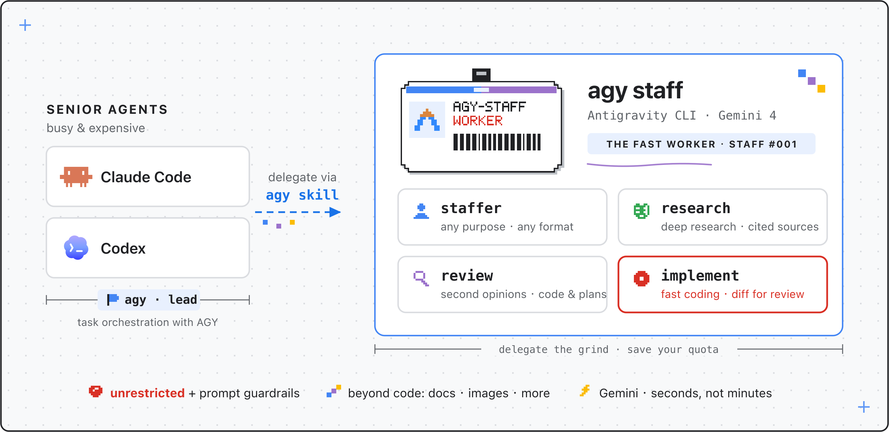
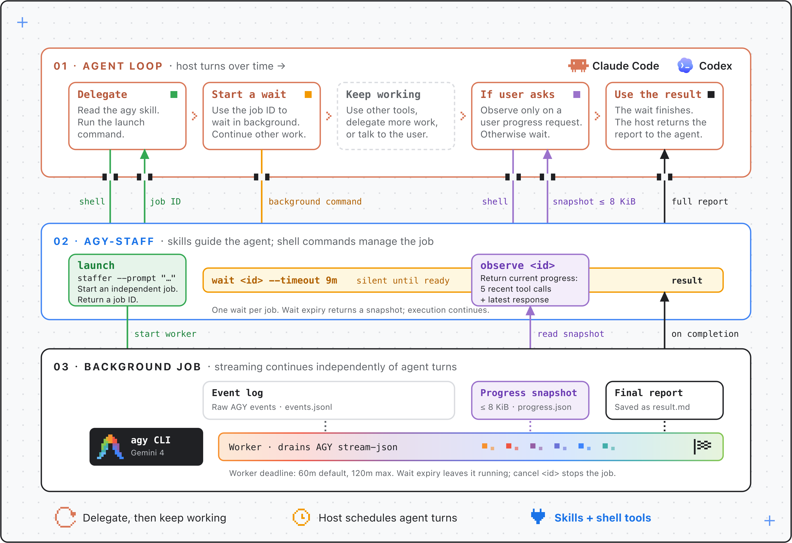

<p align="center"></p>

<p align="center"><a href="README.md">English</a> | <a href="README.zh-CN.md">Simplified Chinese</a></p>

<p align="center"><a href="https://antigravity.google/product/antigravity-cli"></a> </p>

<p align="center"><a href="LICENSE"></a></p>

Hire Google's Antigravity CLI (`agy`) as a staffer for **Claude Code** and **OpenAI Codex**. This fork of [keli-wen/agy-staff](https://github.com/keli-wen/agy-staff) ships one self-contained skill, `skills/agy/`, instead of upstream's plugin and persona skills.



**[Install](#install) · [Examples](#examples) · [Core design](#core-design) · [Upgrade](#upgrade)**

## What & Why

The `agy` skill lets your senior agent delegate to `agy`, which runs Gemini 4: Neon for deep reasoning, Hydrogen for fast everyday work. One skill covers five modes — `staffer` (general-purpose), `research`, `review` (code **and** plans/decisions), `implement`, and the tool-free `ask` — plus background job management and guidance for leading a larger task.

Your main agent's quota is better spent orchestrating than grinding through every survey and review itself. An agy worker gives you a fast lane — second opinions in seconds, research and reviews on Gemini 4 Neon, scoped implementation handled off to the side while you keep moving. And where speed isn't the point, a second model family looking at the same code buys coverage your main agent can't give itself.


## Install

### For humans

Step 1 — install the Antigravity CLI ([official docs](https://antigravity.google/docs/cli/install)) and log in by running `agy` once. Node.js is also required.

```bash
curl -fsSL https://antigravity.google/cli/install.sh | bash
```

Step 2 — install the skill for Claude Code and Codex with [aghub-cli](https://github.com/audichuang/aghub), which copies `skills/agy/` to `~/.aghub/agy` and links it into each agent:

```bash
aghub-cli -g -a claude,codex source sync audichuang/agy-staff --skill agy --install-missing --yes
```

Smoke test (tool-free, no setup):

```bash
node ~/.aghub/agy/companion/agy-companion.mjs ask --prompt "reply with OK"
```

> [!IMPORTANT]
> **There is no mandatory setup step.** `staffer`, `research`, `review` and `implement` run **unrestricted** by default: agy can inspect the repo, run commands, and edit files. The prompts adapt to the current repo state — for example, when `implement` starts in a dirty workspace, the companion tells agy which files already had changes and reminds it not to overwrite or deliver unrelated user work. If the task asks for a commit, push, or PR, agy can do that delivery; otherwise it leaves a working-tree diff for review. These prompt instructions do not provide permission isolation.
> `setup` + `--restricted` is **optional hardening** for untrusted input — per run (`--restricted`) or as a per-repo default (`setup --restrict review,research`). `setup` dry-runs and asks before writing anything; read the [permission notes](docs/REFERENCE.md#optional-hardening-setup) first — the allowlist is prefix-matched, applies machine-wide, and a restricted run can return less than an unrestricted one.

### For agents

Paste this into any coding agent:

```
Read the raw text of https://raw.githubusercontent.com/audichuang/agy-staff/master/docs/INSTALL_FOR_AGENTS.md (curl it — do not
work from a summary) and follow it to install and verify the agy skill.
Respond in the user's language.
```

### Upgrade

```bash
aghub-cli -g -a claude,codex source sync audichuang/agy-staff --skill agy --update --yes
```

A session that started before the upgrade may still hold the old skill text; start a new session to pick it up.

## Examples

Ask your agent in plain language, or invoke the skill directly (`/agy …` in Claude Code, `$agy …` in Codex):

| Use case | Example request |
|---|---|
| Lead an ongoing task | "have agy investigate the options, draft a proposal, and revise it with my feedback" |
| Quick second opinion | `/agy ask what's your backend model` |
| A general task | `/agy staffer summarize the open TODOs in this repo` |
| Generate an image | `/agy staffer generate a pixel-art robot mascot, save it as assets/mascot.png` |
| Review the working tree | `/agy review Review the current working tree` |
| Review a PR | `/agy review Review PR #730` |
| Review a plan or decision | `/agy review Challenge the migration plan in docs/plan.md` |
| Survey a topic | `/agy research how does auth work in this repo` |
| Implement a scoped fix | `/agy implement fix the flaky retry test` |
| Job ops (wait/status/cancel/continue) | "is the agy job done?", "continue: also check the error path" |

`review` is fully prompt-based: you describe the subject and agy gathers the evidence itself (`gh pr view`, `git diff`, reading the file) — there is no flag for handing it a diff. It has two flavors, routed by subject: code review (severity-ranked findings) and general review (a multi-angle challenge of a plan, design, or decision).

`staffer` also covers agy's native tools without a dedicated mode, including **image generation** (`generate_image`).

## Core design

For a larger task, the skill's lead guidance (`skills/agy/references/lead.md`) has your current agent orient enough to frame the assignment, delegate substantive work to `staffer` by default, wait for the result, then assess it and integrate or follow up. Specialist modes add dedicated guidance when useful; `ask` is for one-shot questions and smoke tests. The host keeps cross-task decisions, acceptance, integration, and delivery.

`ask` answers in the same call. The other modes return a job id and a collection command, `wait <id> --timeout 9m`. Your agent waits using the host's available capabilities, with one independent background wait per job where supported.

The main agent waits for the final result by default. If you explicitly ask about progress, it can use `observe` to read a snapshot of recent tool activity and response text; it does not query progress for routine updates. Once the task finishes, `wait` or `result` delivers the full report. Expiring a wait leaves the worker running.

The timeline below follows a background task from delegation to completion.

[](assets/integration.svg)

Jobs have a separate execution deadline: default 60 minutes, configurable at launch with `--timeout` up to 120 minutes. Use `cancel` to stop execution, or explicitly request `continue` or `restart` after inspecting the existing work. The host harness controls when your agent receives a background result.

**Full reference →** [docs/REFERENCE.md](docs/REFERENCE.md) (flags, permission model, jobs/state, troubleshooting). **Release notes →** [docs/releases/](docs/releases/) (up to v0.7.3 they describe upstream's plugin).

## Contributing

- **Run the tests**: `npm test`. The standard suite uses temporary repos and HOME directories with a fake `agy`, plus focused module tests. Keep regression tests offline and independent of personal settings. Real AGY validation is a separate opt-in suite described in [tests/README.md](tests/README.md).
- **Docs come in pairs**: `README.md` / `README.zh-CN.md` and `docs/REFERENCE.md` / `docs/REFERENCE.zh-CN.md` are kept in sync. Change one, change its counterpart.
- **`skills/agy/` is the install payload**: SKILL.md, `references/` (read on demand), `templates/` (the prompts sent to agy) and `companion/` (the entrypoint handles modes and job commands; separate modules handle streaming execution, observations and state locking). Keep anything that isn't payload out of it.

## License

MIT — see [LICENSE](LICENSE).
