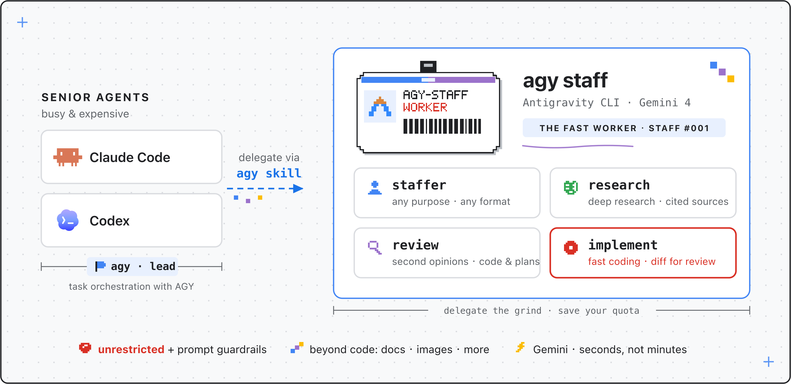
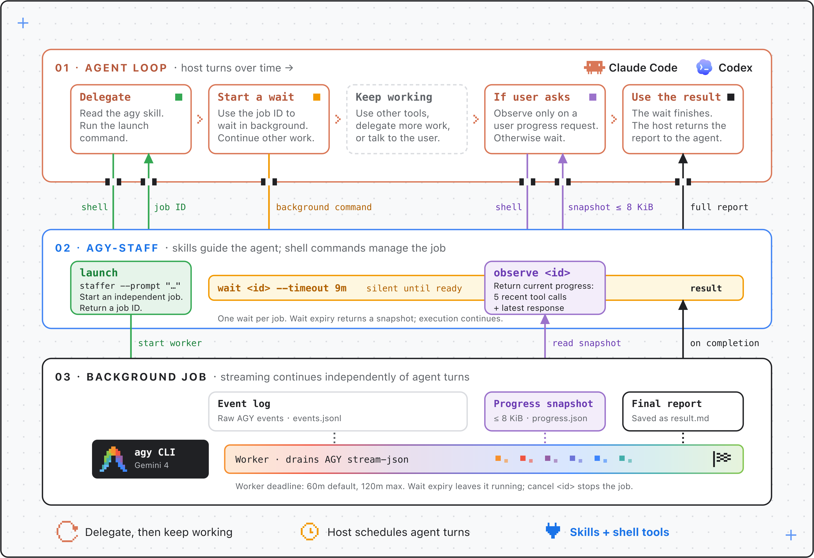

<p align="center"></p>

<p align="center"><a href="README.md">English</a> | <a href="README.zh-CN.md">简体中文</a></p>

<p align="center"><a href="https://antigravity.google/product/antigravity-cli"></a> </p>

<p align="center"><a href="LICENSE"></a></p>

把 Google 的 Antigravity CLI（`agy`）雇来当 **Claude Code** 和 **OpenAI Codex** 的「员工」。这个 fork 自 [keli-wen/agy-staff](https://github.com/keli-wen/agy-staff)，只提供一个自包含的技能 `skills/agy/`，不再使用上游的插件和角色技能。



**[安装](#安装) · [示例](#示例) · [核心设计](#核心设计) · [升级](#升级)**

## 它适合做什么

`agy` 技能让你的主力 agent 把工作委派给 `agy`，由它运行 Gemini 4：Neon 负责深度推理，Hydrogen 负责快速的日常工作。一个技能涵盖五种模式——`staffer`（通用任务）、`research`、`review`（代码**和**方案／决策）、`implement`，以及不使用工具的 `ask`——外加后台任务管理，以及主导较大任务时的指导。

主 agent 的额度更适合用来编排，而不是亲自做每一次调研和审查。agy 员工提供了一条快车道：几秒钟就能给出第二意见，调研和审查交给 Gemini 4 Neon，范围明确的实现任务放到一旁处理，你继续做手头的事。即使不追求速度，让另一个模型家族审同一份代码，也能带来主力 agent 自己给不了的覆盖面。


## 安装

### 手动安装

第 1 步——安装 Antigravity CLI（[官方文档](https://antigravity.google/docs/cli/install)），并运行一次 `agy` 完成登录。还需要 Node.js。

```bash
curl -fsSL https://antigravity.google/cli/install.sh | bash
```

第 2 步——用 [aghub-cli](https://github.com/audichuang/aghub) 为 Claude Code 和 Codex 安装技能，它会把 `skills/agy/` 复制到 `~/.aghub/agy`，并链接到各个 agent：

```bash
aghub-cli -g -a claude,codex source sync audichuang/agy-staff --skill agy --install-missing --yes
```

冒烟测试（不使用工具，无需任何配置）：

```bash
node ~/.aghub/agy/companion/agy-companion.mjs ask --prompt "reply with OK"
```

> [!IMPORTANT]
> **没有必须执行的配置步骤。** `staffer`、`research`、`review` 和 `implement` 默认以 **unrestricted** 方式运行：agy 可以查看仓库、运行命令和修改文件。提示词会根据当前仓库状态调整——例如，`implement` 在有未提交改动的工作区中启动时，companion 会告诉 agy 哪些文件已经有改动，并提醒它不要覆盖或交付无关的用户工作。任务要求提交、推送或创建 PR 时，agy 可以完成这些交付；否则它会留下工作区差异供你审查。这些提示词约定不能提供权限隔离。
> `setup` + `--restricted` 是面向不可信输入的**可选加固**——可以按次启用（`--restricted`），也可以设为仓库默认（`setup --restrict review,research`）。`setup` 会先预演，写入任何内容前都会询问；请先阅读[权限说明](docs/REFERENCE.zh-CN.md#可选加固-setup)——允许列表按前缀匹配、作用于整台机器，而且受限运行返回的内容可能比不受限的更少。

### 让 agent 帮你安装

把下面这段话交给任意 coding agent：

```
Read the raw text of https://raw.githubusercontent.com/audichuang/agy-staff/master/docs/INSTALL_FOR_AGENTS.md (curl it — do not
work from a summary) and follow it to install and verify the agy skill.
Respond in the user's language.
```

### 升级

```bash
aghub-cli -g -a claude,codex source sync audichuang/agy-staff --skill agy --update --yes
```

升级之前启动的会话可能仍然保留旧的技能文本；请新开一个会话来加载新版本。

## 示例

用自然语言向你的 agent 提出请求，或直接调用技能（Claude Code 中用 `/agy …`，Codex 中用 `$agy …`）：

| 想做的事 | 示例 |
|---|---|
| 主导持续推进的任务 | “让 agy 调研可选方案，起草提案，再根据我的反馈修订” |
| 快速获得第二意见 | `/agy ask what's your backend model` |
| 交办一个通用任务 | `/agy staffer summarize the open TODOs in this repo` |
| 生成图片 | `/agy staffer generate a pixel-art robot mascot, save it as assets/mascot.png` |
| 审查工作区改动 | `/agy review Review the current working tree` |
| 审查某个 PR | `/agy review Review PR #730` |
| 审查方案或决策 | `/agy review Challenge the migration plan in docs/plan.md` |
| 调研某个主题 | `/agy research how does auth work in this repo` |
| 实现范围明确的修复 | `/agy implement fix the flaky retry test` |
| 任务操作（等待／状态／取消／继续） | “agy 的任务完成了吗？”、“继续：再检查一下错误路径” |

`review` 完全基于提示词：你描述审查对象，agy 自己收集证据（`gh pr view`、`git diff`、读取文件）——没有用来传入 diff 的参数。它按对象分成两种方式：代码审查（按严重程度列出问题）和通用审查（对方案、设计或决策做多角度的挑战）。

`staffer` 没有专门的模式，也可以使用 agy 的原生工具，包括**图像生成**（`generate_image`）。

## 核心设计

对于较大的任务，技能中的主导指导（`skills/agy/references/lead.md`）让当前的 agent 先了解到足以明确任务，默认把实质性工作委派给 `staffer`，等待结果返回，再验收并整合或追加任务。专门的模式在有帮助时附带专门指导；`ask` 用于一次性问答和冒烟测试。跨任务的决策、验收、整合和交付仍由主 agent 负责。

`ask` 在同一次调用中返回答案。其他模式会返回任务 ID 和收取结果的命令 `wait <id> --timeout 9m`。你的 agent 根据所在环境提供的能力等待任务；在支持的环境中，为每个任务保留一个独立的后台等待。

主 agent 默认等待最终结果。你明确询问进展时，它才用 `observe` 读取最近工具活动和回答文本的快照；例行汇报不会查询进度。任务完成后，`wait` 或 `result` 返回完整报告。等待到期不会停止 worker。

下图按时间顺序展示一次后台任务，从委派到完成。

[](assets/integration.svg)

任务本身有独立的执行时限：默认 60 分钟，可以在启动时用 `--timeout` 调整，最长 120 分钟。需要停止执行时使用 `cancel`，或在检查现有工作后明确要求 `continue` 或 `restart`。agent 何时收到后台结果，由宿主环境决定。

**完整参考 →** [docs/REFERENCE.zh-CN.md](docs/REFERENCE.zh-CN.md)（参数、权限模型、任务与状态、疑难排查）。**发布说明 →** [docs/releases/](docs/releases/)（v0.7.3 及之前的版本描述的是上游的插件）。

## 参与贡献

- **运行测试**：`npm test`。标准测试使用临时仓库、临时 HOME 目录和假的 `agy`，另有针对单个模块的测试。回归测试应保持离线，且不依赖个人设置。真实 AGY 的验证是单独启用的测试，见[测试说明](tests/README.md)。
- **文档成对维护**：`README.md` / `README.zh-CN.md` 与 `docs/REFERENCE.md` / `docs/REFERENCE.zh-CN.md` 保持同步。改了一个，就要改对应的另一个。
- **`skills/agy/` 是安装内容**：SKILL.md、`references/`（按需读取）、`templates/`（发给 agy 的提示词）和 `companion/`（入口负责模式和任务命令；独立模块负责流式执行、观测和状态锁）。不属于安装内容的东西不要放进去。

## 许可证

MIT——详见 [LICENSE](LICENSE)。
